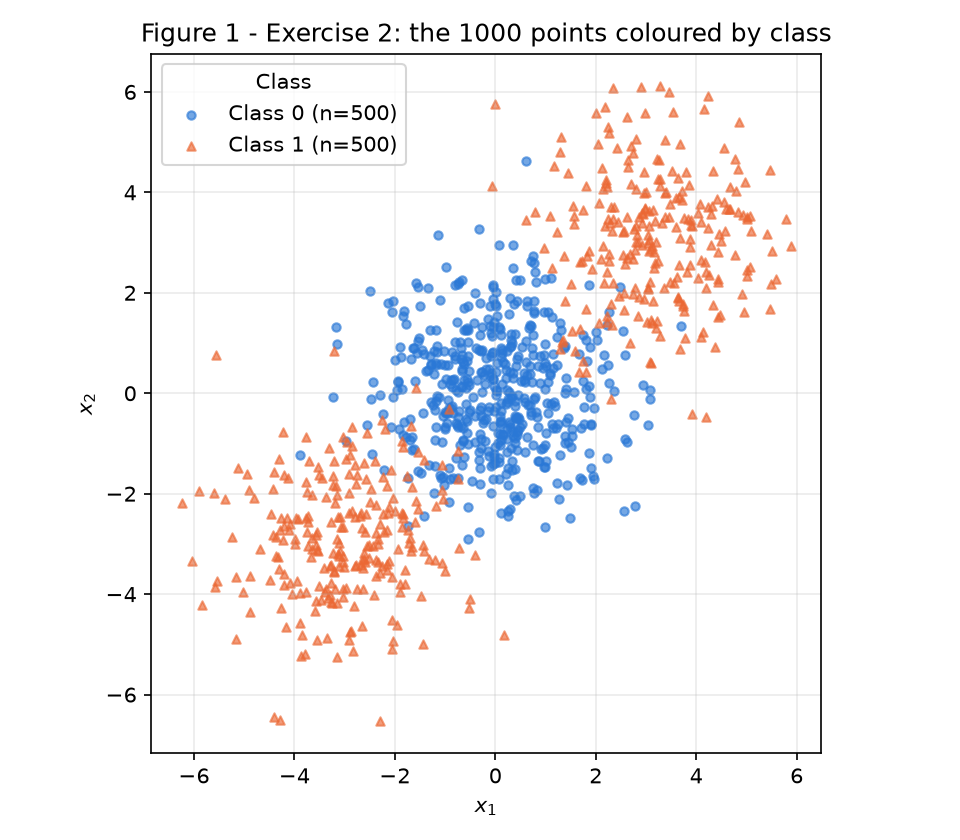
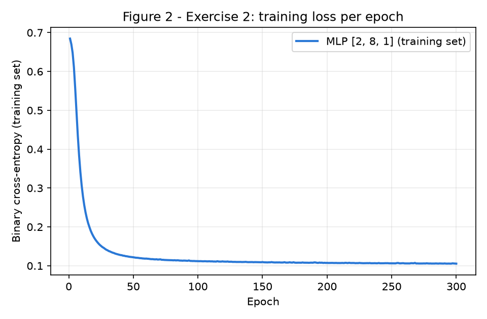
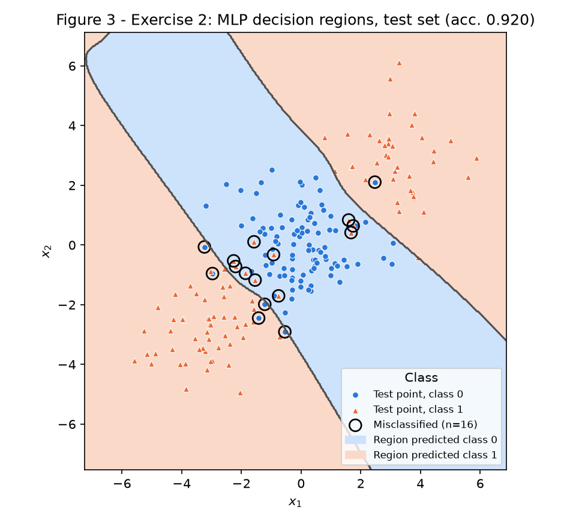
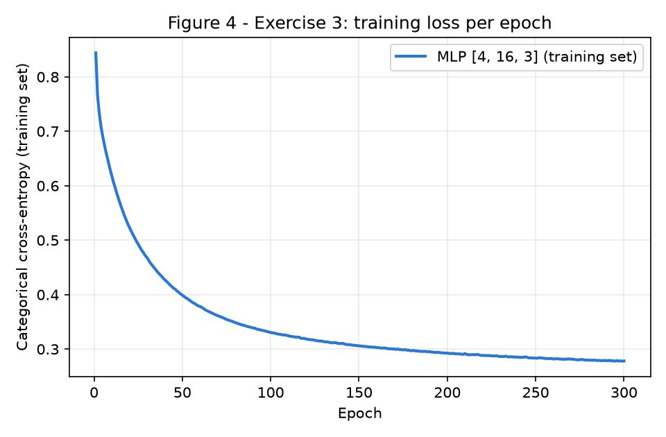
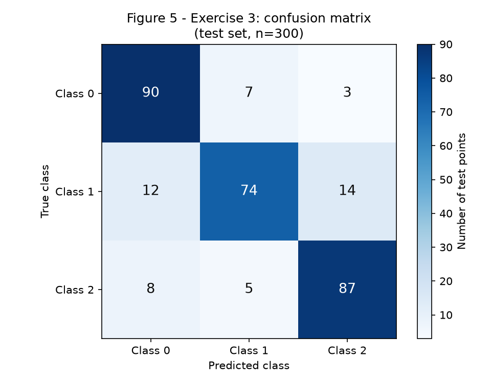
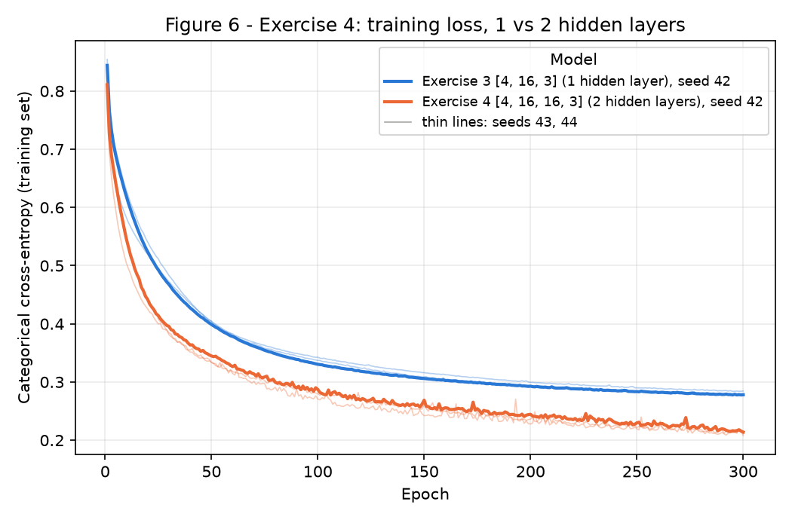

# MLP

!!! abstract "Assignment"

    [Exercises → MLP](https://insper.github.io/ann-dl/2026.2/exercises/mlp/){:target='_blank'}

**Implementation approach.** The network lives in a single module,
[`code/mlp.py`](https://github.com/Thaisrs165/ann-dl-2026-2/blob/main/docs/exercises/mlp/code/mlp.py):
an `MLP` class that takes the layer sizes (e.g. `[2, 8, 1]` or `[4, 16, 16, 3]`) and the loss as
arguments. Activations, losses, the forward pass, the backward pass (every gradient derived by
hand, no autodiff) and the gradient-descent update are written in plain `numpy`; no TensorFlow,
PyTorch or `MLPClassifier` is used. scikit-learn is used only for `make_blobs`,
`make_classification`, `train_test_split`, `confusion_matrix` and the `LogisticRegression`
baselines the statement asks for. Exercises 2, 3 and 4 each have their own script, and all of
them **import the same `MLP` class without modifying it** — Exercise 3 only changes arguments
(`layer_sizes`, `loss="cce"`, hyperparameters), and Exercise 4 only changes `layer_sizes`.

Every script creates one `rng = np.random.default_rng(42)` and passes it to the network, which
uses it for the initial weights and for the mini-batch shuffle of every epoch; the dataset
generators and the split use `random_state=42` as prescribed. The only exception is the seed
study of Exercise 4B, which by design repeats the comparison with `default_rng(43)` and
`default_rng(44)` as well. To reproduce everything, run from the repository root:

```shell
python docs/exercises/mlp/code/exercise2_binary.py
python docs/exercises/mlp/code/exercise3_multiclass.py
python docs/exercises/mlp/code/exercise4_depth.py
```

The core of the implementation, used by all three exercises:

``` { .python .copy .select linenums='1' title="mlp.py — activations and losses" }
--8<-- "docs/exercises/mlp/code/mlp.py:activations-losses"
```

``` { .python .copy .select linenums='1' title="mlp.py — forward pass, backward pass, update, training loop" }
--8<-- "docs/exercises/mlp/code/mlp.py:mlp-class"
```

## Exercise 1

### One Step of Backpropagation, by Hand

Network: 2 inputs → 2 hidden \(\tanh\) units → 1 \(\tanh\) output, loss \(L=(y-\hat y)^2\).
Given: \(\mathbf{x}=[0.5,\,-0.2]\), \(y=1.0\),
\(\mathbf{W}^{(1)}=\begin{bmatrix}0.3 & -0.1\\ 0.2 & 0.4\end{bmatrix}\),
\(\mathbf{b}^{(1)}=[0.1,\,-0.2]\), \(\mathbf{W}^{(2)}=[0.5,\,-0.3]\), \(b^{(2)}=0.2\), \(\eta=0.3\).
Row \(i\) of \(\mathbf{W}^{(1)}\) holds the weights into hidden unit \(i\). All values are done by
hand below and rounded to 6 decimals (intermediate values were carried at full precision).

### A — Forward pass

**Hidden pre-activations** \(\mathbf{z}^{(1)}=\mathbf{W}^{(1)}\mathbf{x}+\mathbf{b}^{(1)}\):

\[
\begin{aligned}
z^{(1)}_1 &= 0.3(0.5) + (-0.1)(-0.2) + 0.1 = 0.15 + 0.02 + 0.1 = 0.270000\\
z^{(1)}_2 &= 0.2(0.5) + 0.4(-0.2) + (-0.2) = 0.10 - 0.08 - 0.2 = -0.180000
\end{aligned}
\]

**Hidden activations** \(\mathbf{h}^{(1)}=\tanh(\mathbf{z}^{(1)})\):

\[
h^{(1)}_1=\tanh(0.27)=0.263625,\qquad h^{(1)}_2=\tanh(-0.18)=-0.178081
\]

**Output pre-activation** \(u^{(2)}=\mathbf{W}^{(2)}\mathbf{h}^{(1)}+b^{(2)}\):

\[
u^{(2)} = 0.5(0.263625) + (-0.3)(-0.178081) + 0.2 = 0.131812 + 0.053424 + 0.2 = 0.385237
\]

**Output and loss:**

\[
\hat y=\tanh(0.385237)=0.367247,\qquad
L=(1-0.367247)^2=(0.632753)^2=0.400377
\]

### B — Backward pass

**Start at the output.**

\[
\frac{\partial L}{\partial \hat y} = -2(y-\hat y) = -2(0.632753) = -1.265507
\]

**Through the output \(\tanh\)**, using \(\frac{d}{du}\tanh(u)=1-\tanh^2(u)=1-\hat y^2\):

\[
1-\hat y^2 = 1-0.367247^2 = 0.865130,\qquad
\frac{\partial L}{\partial u^{(2)}} = \frac{\partial L}{\partial \hat y}(1-\hat y^2)
= -1.265507 \times 0.865130 = -1.094828
\]

**Output layer.** Since \(u^{(2)}=\sum_i W^{(2)}_i h^{(1)}_i + b^{(2)}\), we have
\(\partial u^{(2)}/\partial W^{(2)}_i = h^{(1)}_i\) and \(\partial u^{(2)}/\partial b^{(2)}=1\):

\[
\begin{aligned}
\frac{\partial L}{\partial W^{(2)}_1} &= -1.094828 \times 0.263625 = -0.288624\\
\frac{\partial L}{\partial W^{(2)}_2} &= -1.094828 \times (-0.178081) = 0.194968\\
\frac{\partial L}{\partial b^{(2)}} &= -1.094828
\end{aligned}
\]

**Propagate back to the hidden layer.** \(\partial u^{(2)}/\partial h^{(1)}_i = W^{(2)}_i\):

\[
\frac{\partial L}{\partial h^{(1)}_1} = -1.094828 \times 0.5 = -0.547414,\qquad
\frac{\partial L}{\partial h^{(1)}_2} = -1.094828 \times (-0.3) = 0.328448
\]

Through the hidden \(\tanh\): \(1-(h^{(1)}_1)^2 = 1-0.263625^2 = 0.930502\) and
\(1-(h^{(1)}_2)^2 = 1-0.178081^2 = 0.968287\), so

\[
\frac{\partial L}{\partial z^{(1)}_1} = -0.547414 \times 0.930502 = -0.509370,\qquad
\frac{\partial L}{\partial z^{(1)}_2} = 0.328448 \times 0.968287 = 0.318032
\]

**Hidden layer.** \(z^{(1)}_i=\sum_j W^{(1)}_{ij}x_j + b^{(1)}_i\), so
\(\partial L/\partial W^{(1)}_{ij} = (\partial L/\partial z^{(1)}_i)\,x_j\) and
\(\partial L/\partial b^{(1)}_i = \partial L/\partial z^{(1)}_i\):

\[
\frac{\partial L}{\partial \mathbf{W}^{(1)}} =
\begin{bmatrix}
-0.509370(0.5) & -0.509370(-0.2)\\
0.318032(0.5) & 0.318032(-0.2)
\end{bmatrix}
=
\begin{bmatrix}
-0.254685 & 0.101874\\
0.159016 & -0.063606
\end{bmatrix},
\qquad
\frac{\partial L}{\partial \mathbf{b}^{(1)}} = [-0.509370,\; 0.318032]
\]

### C — Parameter update

\(\theta \leftarrow \theta - \eta\,\partial L/\partial\theta\) with \(\eta = 0.3\):

| Parameter | Old | Gradient | \(-\eta\cdot\)gradient | **New** |
|---|---:|---:|---:|---:|
| \(W^{(2)}_1\) | 0.5 | −0.288624 | +0.086587 | **0.586587** |
| \(W^{(2)}_2\) | −0.3 | 0.194968 | −0.058490 | **−0.358490** |
| \(b^{(2)}\) | 0.2 | −1.094828 | +0.328448 | **0.528448** |
| \(W^{(1)}_{11}\) | 0.3 | −0.254685 | +0.076405 | **0.376405** |
| \(W^{(1)}_{12}\) | −0.1 | 0.101874 | −0.030562 | **−0.130562** |
| \(W^{(1)}_{21}\) | 0.2 | 0.159016 | −0.047705 | **0.152295** |
| \(W^{(1)}_{22}\) | 0.4 | −0.063606 | +0.019082 | **0.419082** |
| \(b^{(1)}_1\) | 0.1 | −0.509370 | +0.152811 | **0.252811** |
| \(b^{(1)}_2\) | −0.2 | 0.318032 | −0.095410 | **−0.295410** |

(The statement counts "eight parameters"; the network actually has nine — 4 + 2 + 2 + 1 — and all
nine are updated above.)

**Would the loss go up or down on a second forward pass? Down.** Every parameter moved in the
direction opposite to its gradient, and to first order the change in loss is
\(\Delta L \approx -\eta\,\lVert\nabla L\rVert^2 = -0.3 \times 1.785141 = -0.535542 < 0\).
Intuitively: the prediction \(\hat y = 0.3672\) is too low for the target 1, so the update pushes
\(u^{(2)}\) up — \(b^{(2)}\) grows, \(W^{(2)}_1\) grows because \(h^{(1)}_1>0\), \(W^{(2)}_2\)
becomes more negative because \(h^{(1)}_2<0\) — and the hidden layer moves its activations in
the directions that help. Repeating the forward pass of item A with the new parameters gives
\(\mathbf{z}^{(1)}=[0.467126,\,-0.303079]\), \(\mathbf{h}^{(1)}=[0.435874,\,-0.294127]\),
\(u^{(2)}=0.889568\), \(\hat y=0.711181\) and **\(L=0.083417\)**, down from 0.400377. The actual
drop (0.316960) is smaller than the first-order estimate because \(\eta=0.3\) is a large step and
the loss is curved; the sign, however, is what the gradient guarantees for a small enough step,
and here it holds.

## Exercise 2

### A — Generate the data

**Approach.** The data are generated exactly as in the statement and split 80/20 with
`stratify=y`, giving 800 training points (400 per class) and 200 test points (100 per class).

``` { .python .copy .select linenums='1' }
--8<-- "docs/exercises/mlp/code/exercise2_binary.py:ex2-data"
```


/// caption
**Figure 1 —** The 1000 points of Exercise 2. Class 0 (blue circles, 500 points) is one cluster
at the origin; Class 1 (orange triangles, 500 points) is two clusters of 250 at \((3,3)\) and
\((-3,-3)\), on opposite sides of Class 0.
///

### B — Establish the baseline

``` { .python .copy .select linenums='1' }
--8<-- "docs/exercises/mlp/code/exercise2_binary.py:ex2-baseline"
```

**Result.** Logistic-regression test accuracy: **0.4750 (47.50%)** — below chance. The fitted
coefficients are tiny, \(\mathbf{w} = [0.0296,\ 0.0015]\), intercept \(-0.0031\), so the model
predicts \(P(\text{class }1)\) between 0.4566 and 0.5438 for every test point. Item D explains why.

### C — Implement the MLP

**Approach.** The `MLP` class (shown at the top of this page) is used with
`layer_sizes=[2, 8, 1]` and `loss="bce"`: 2 inputs → 8 \(\tanh\) hidden units → 1 sigmoid
output, binary cross-entropy loss. Weights start at \(\mathcal N(0, 1/\text{fan\_in})\), biases at
zero. Training is mini-batch gradient descent: each epoch reshuffles the training set with the
shared `rng`, and every batch runs forward → backward → update; the full training-set loss is
recorded at the end of each epoch.

For a sigmoid output \(\hat y=\sigma(u)\) with BCE
\(L=-\frac1N\sum[y\log\hat y+(1-y)\log(1-\hat y)]\), using \(\sigma'(u)=\hat y(1-\hat y)\):
\(\frac{\partial L}{\partial u}=\frac1N\left(-\frac{y}{\hat y}+\frac{1-y}{1-\hat y}\right)\hat y(1-\hat y)
=\frac1N(\hat y-y)\). That is the `delta = (activations[-1] - y) / n` line in `backward`; from there
each hidden layer uses the \(\tanh\) derivative \(1-h^2\), exactly as in Exercise 1.

``` { .python .copy .select linenums='1' }
--8<-- "docs/exercises/mlp/code/exercise2_binary.py:ex2-train"
```

| Setting | Value |
|---|---|
| Architecture | `[2, 8, 1]` — 1 hidden layer of 8 \(\tanh\) units, sigmoid output (33 parameters) |
| Loss | binary cross-entropy |
| Learning rate \(\eta\) | 0.1 |
| Epochs / batch size | 300 / 32 |
| Final training loss | 0.1054 (epoch 1: 0.6846; epoch 50: 0.1218) |
| Training accuracy | 0.9663 |
| **Test accuracy** | **0.9200 (92.00%)** — 16 of 200 test points misclassified |


/// caption
**Figure 2 —** Training-set binary cross-entropy after every epoch. The loss falls from 0.6846
(≈ \(\ln 2\), i.e. a coin flip) to about 0.12 within 50 epochs, then flattens at 0.1054: the
remaining loss comes from points in the overlap between the clusters, which no boundary can
separate.
///


/// caption
**Figure 3 —** The trained network evaluated on a 400 × 400 grid: orange = predicted Class 1,
blue = predicted Class 0, grey line = the decision boundary. Test points are drawn on top;
circled points are the 16 misclassified ones, all in the overlap zones between the central
cluster and the outer clusters.
///

### D — Analysis

**What Figure 3 shows.** The region the MLP assigns to Class 1 is **two disconnected pieces**:
one in the upper-right and one in the lower-left, separated by a diagonal blue band (Class 0)
that runs from upper-left to lower-right through the origin. Along the line \(x_1=x_2\) — where
both Class 1 clusters sit — the prediction switches from 1 to 0 at \(t\approx-1.58\) and back
to 1 at \(t\approx 1.62\): Class 1 is predicted for \(t<-1.58\) and for \(t>1.62\). The network
built this from two roughly parallel boundaries — each hidden \(\tanh\) unit contributes a soft
straight cut, and the output combines them into "outside the band".

**Why no single straight line can do it.** A straight line splits the plane into two
half-planes, and a half-plane is convex: if it contains two points, it contains the segment
between them. Here the two Class 1 centres \((3,3)\) and \((-3,-3)\) have the Class 0 centre
\((0,0)\) exactly at their midpoint. Any half-plane that contains both Class 1 clusters must
therefore contain the Class 0 cluster as well. The best a line can do is give up on one Class 1
cluster — for example, the line \(x_1+x_2=3\), halfway between \((0,0)\) and \((3,3)\), scores
0.6850 on the test set.

**Why logistic regression is *below* 50%, not just below 90%.** The data are point-symmetric
around the origin: flipping \((x_1,x_2)\to(-x_1,-x_2)\) maps Class 1 onto itself and Class 0 onto
itself. Any tilt of the line that helps with one Class 1 cluster hurts equally with the other,
so the cross-entropy-optimal line is degenerate — \(\mathbf w\approx 0\). The fitted
\(\mathbf w=[0.0296, 0.0015]\) confirms it: every prediction is within 0.05 of 0.5, so which side
of 0.5 a point falls on is decided by sampling noise in the fitted coefficients, not by any
structure in the data. The result is essentially a coin flip, and this particular coin landed
at 0.4750. The MLP does not need a line: the hidden layer maps the points to a space where
"outside the diagonal band" becomes linearly separable for the output unit, which is why it
reaches 0.9200.

## Exercise 3

### A — Generate the data

**Approach.** The data are generated exactly as in the statement; the stratified 80/20 split
gives 1200 training points (399 / 399 / 402) and 300 test points (100 per class). The data
function is shared with Exercise 4 so both exercises are guaranteed to see the same split.

``` { .python .copy .select linenums='1' }
--8<-- "docs/exercises/mlp/code/exercise3_multiclass.py:ex3-config"
```

### B — Adapt the network

**What changed: only arguments.** The same `MLP` class from `mlp.py` is imported **unchanged**:
`forward`, `backward` and `update` are the same lines of code that trained the binary network.
Exercise 3 passes `layer_sizes=[4, 16, 3]` (three output units) and `loss="cce"`, which plugs in
`softmax` as the output activation and `categorical_cross_entropy` as the loss; the labels are
converted to one-hot vectors with `one_hot`. This works because softmax + categorical
cross-entropy has the same output gradient as sigmoid + BCE, derived below.

**Deriving \(\partial L/\partial u\) for softmax + cross-entropy.** For one sample with output
pre-activations \(u_1,\dots,u_K\), one-hot target \(\mathbf y\) (\(\sum_k y_k=1\)) and

\[
\hat y_k=\frac{e^{u_k}}{\sum_{m} e^{u_m}},\qquad L=-\sum_k y_k\log\hat y_k .
\]

*Step 1 — derivative of softmax.* By the quotient rule, with \(S=\sum_m e^{u_m}\):

\[
\frac{\partial \hat y_k}{\partial u_j}=
\begin{cases}
\dfrac{e^{u_k}S-e^{u_k}e^{u_k}}{S^2}=\hat y_k(1-\hat y_k) & j=k\\[2ex]
\dfrac{0-e^{u_k}e^{u_j}}{S^2}=-\hat y_k\hat y_j & j\neq k
\end{cases}
\quad=\;\hat y_k(\delta_{kj}-\hat y_j).
\]

*Step 2 — chain rule through the loss.* \(\partial L/\partial\hat y_k=-y_k/\hat y_k\), so

\[
\frac{\partial L}{\partial u_j}
=\sum_k\left(-\frac{y_k}{\hat y_k}\right)\hat y_k(\delta_{kj}-\hat y_j)
=-\sum_k y_k\delta_{kj}+\hat y_j\sum_k y_k
=-y_j+\hat y_j\cdot 1 .
\]

\[
\boxed{\;\frac{\partial L}{\partial u_j}=\hat y_j-y_j\;}
\qquad\text{(and }\tfrac1N(\hat{\mathbf y}-\mathbf y)\text{ for the mean over a batch of }N\text{)}
\]

**Why it is so simple.** The \(1/\hat y_k\) from the log cancels the \(\hat y_k\) factor of the
softmax derivative, and the normalisation \(\sum_k y_k=1\) removes the sum. The result is just
"prediction minus target", with no softmax Jacobian left — the same expression as for
sigmoid + BCE in Exercise 2 (the sigmoid is the \(K=2\) case of the softmax). That is why
`backward` can start every network with `delta = (activations[-1] - y) / n` without knowing which
loss is in use. It also explains why the gradient never vanishes for a confident wrong answer:
if \(\hat y_j\to 0\) for the true class, \(\partial L/\partial u_j\to -1\), the largest it can be.

### C — Train and evaluate

``` { .python .copy .select linenums='1' }
--8<-- "docs/exercises/mlp/code/exercise3_multiclass.py:ex3-train"
```

| Setting | Value |
|---|---|
| Architecture | `[4, 16, 3]` — 1 hidden layer of 16 \(\tanh\) units, softmax output (131 parameters) |
| Loss | categorical cross-entropy |
| Learning rate \(\eta\) | 0.05 |
| Epochs / batch size | 300 / 32 |
| Final training loss | 0.2781 (epoch 1: 0.8441) |
| Training accuracy | 0.9025 |
| **Test accuracy** | **0.8367 (83.67%)** — 251 of 300 |


/// caption
**Figure 4 —** Training-set categorical cross-entropy after every epoch. It falls quickly over
the first ~50 epochs and then keeps decreasing slowly, ending at 0.2781 after 300 epochs.
///


/// caption
**Figure 5 —** Confusion matrix on the 300 test points (rows: true class; columns: predicted
class). Class 0: 90 correct; Class 1: 74 correct (12 → class 0, 14 → class 2); Class 2: 87
correct.
///

### D — Analysis

**Most-confused pair: classes 1 and 2.** In Figure 5 the largest off-diagonal cell is
*true 1 → predicted 2* (14 points). Counting both directions, the pairs 1↔2 (14 + 5) and 0↔1
(12 + 7) are tied at 19 errors each, while 0↔2 has only 11 (3 + 8). So the clearest finding is
that **class 1 is the hard class** — 26 of its 100 test points are misclassified, against 10 for
class 0 and 13 for class 2 — and its most frequent confusion is with class 2.

**Explanation from the cluster structure.** `make_classification` places each of the 6 clusters
(2 per class) around a vertex of a 4-D hypercube with side \(2\times\)`class_sep` \(=2\), and
gives each cluster its own random covariance, so clusters are stretched and some of them overlap
with clusters of other classes. Two measurements on the full dataset (both computed with numpy
in `exercise3_multiclass.py`) show which classes touch:

- **Distance between class means:** 1–2: **1.0055**; 0–2: 2.0911; 0–1: 2.3652. Classes 1 and 2
  are by far the closest — their clusters sit on nearby vertices.
- **Nearest-neighbour overlap:** for every point I find its nearest neighbour in 4-D and record
  that neighbour's class. Cross-class neighbour links: 1–2: **99**, 0–1: 97, 0–2: 62. Class 1 is
  in contact with *both* other classes, which matches the confusion matrix, where class 1 loses
  points in both directions.

``` { .python .copy .select linenums='1' }
--8<-- "docs/exercises/mlp/code/exercise3_multiclass.py:ex3-overlap"
```

Points that sit in the overlap of two clusters from different classes have, locally, the wrong
class as their nearest neighbour: no boundary — however flexible — can classify them correctly,
and they make up most of the remaining test error.

**Baseline comparison.** Multinomial logistic regression reaches **0.6633 (66.33%)** on the same
test set, against **0.8367** for the MLP: the hidden layer adds **+17.33 percentage points**. The
baseline's own confusion matrix makes 57 errors between classes 1 and 2 (32 + 25), against 19
for the MLP. A linear model gives each class one linear score, so each class gets a single
convex region — but each class here is *two* clusters at different vertices of the hypercube,
and a convex region that covers both clusters of a class also swallows whatever lies between
them. The hidden layer lets the network carve each class into several pieces (one per cluster),
which is the same mechanism that solved Exercise 2.

## Exercise 4

### A — Train the deeper network

**Approach.** Same data, split, learning rate (0.05), number of epochs (300) and batch size (32)
as Exercise 3 — all imported directly from `exercise3_multiclass.py` so they cannot drift. The
only change is depth: **`[4, 16, 16, 3]`, two hidden layers of 16 \(\tanh\) units** (403
parameters). The `MLP` class is again reused unchanged.

``` { .python .copy .select linenums='1' }
--8<-- "docs/exercises/mlp/code/exercise4_depth.py:ex4-compare"
```

**Result with seed 42** (the seed of Exercise 3): test accuracy **0.8533 (85.33%)**, final
training loss 0.2140. (For the same seed the Exercise 3 network scores 0.8367 — the seed-42 run
in this script reproduces Exercise 3 exactly.)

### B — Compare

For each seed in {42, 43, 44}, both networks are trained with a fresh
`np.random.default_rng(seed)`, so the two members of a pair share the same seed.

**Comparison table (mean over the 3 seeds):**

| | hidden layers | parameters | final train loss | test accuracy |
|---|---:|---:|---:|---:|
| Exercise 3 `[4, 16, 3]` | 1 | 131 | 0.2803 | 0.8467 |
| Exercise 4 `[4, 16, 16, 3]` | 2 | 403 | 0.2111 | 0.8467 |

**Per seed:**

| Seed | Ex. 3 train loss | Ex. 3 test acc. | Ex. 4 train loss | Ex. 4 test acc. | Ex. 4 − Ex. 3 (test) |
|---:|---:|---:|---:|---:|---:|
| 42 | 0.2781 | 0.8367 | 0.2140 | 0.8533 | +1.67 pp |
| 43 | 0.2846 | 0.8433 | 0.2080 | 0.8400 | −0.33 pp |
| 44 | 0.2782 | 0.8600 | 0.2112 | 0.8467 | −1.33 pp |
| **Mean** | **0.2803** | **0.8467** | **0.2111** | **0.8467** | **+0.00 pp** |

Mean training accuracy: 0.8978 (Exercise 3) vs 0.9222 (Exercise 4).


/// caption
**Figure 6 —** Training-set loss per epoch of the 1-hidden-layer network (blue) and the
2-hidden-layer network (orange), same data, learning rate and budget. Thick lines: seed 42;
thin lines: seeds 43 and 44. The deeper network's loss is lower at every checkpoint (seed mean
at epoch 50: 0.3373 vs 0.4025; at epoch 300: 0.2111 vs 0.2803) and its curve is visibly noisier.
///

### C — Analysis

**What was measured.** The second hidden layer did **not** improve test accuracy: the mean over
three seeds is 0.8467 for both networks, a difference of +0.00 percentage points. The per-seed
differences (+1.67, −0.33, −1.33 pp) have both signs and are as large as the seed-to-seed spread
of each model by itself (standard deviation 1.20 pp for Exercise 3), so there is no detectable
effect of depth here.

**The training loss tells a different story from the test accuracy.** In Figure 6 the deeper
network reaches a clearly lower training loss (0.2111 vs 0.2803) and a higher training accuracy
(0.9222 vs 0.8978) — so it is *not* failing to optimize. But none of that gain reaches the test
set: the gap between train and test accuracy grows from 5.1 pp to 7.6 pp. The extra 272
parameters are being used to fit the training points more tightly, i.e. to memorize the
particular points that fall in the overlap between clusters, which do not generalize.

**Why, from the structure of the data.** The data have only 6 Gaussian clusters in 4-D. A
boundary that separates them only has to be roughly piecewise linear between neighbouring
clusters, and one hidden layer of 16 \(\tanh\) units already provides 16 cuts to build it —
Exercise 2 showed that a single hidden layer is enough to give one class several disconnected
regions. What limits accuracy at ~85% is not the shape of the boundary but the **overlap**
between clusters of different classes (Exercise 3D): points on the wrong side of an overlap
cannot be fixed by any model, deep or shallow. A second layer adds representational power — it
can compose the first layer's cuts into more complex regions — but this dataset has no extra
structure for that power to capture.

**What the extra layer costs.** Three times as many parameters (403 vs 131), more computation
per epoch, a noisier loss curve (Figure 6: at the same \(\eta\), each mini-batch update moves the
deeper model's loss more, so the curve is less smooth), and more capacity to overfit. In this
experiment the optimization cost did not materialize as slower training — the deeper network
actually descended faster per epoch — but the generalization cost did: lower training loss,
same test accuracy.

**What kind of data would reward the extra depth.** Data with *hierarchical* or *compositional*
structure, where useful features are built out of simpler features: images (edges → textures →
parts → objects), audio, or text. Also synthetic problems whose boundary is a composition of
many simple pieces — a checkerboard or a parity function with many cells, nested or
interleaved spirals — where a shallow network would need exponentially many hidden units to
draw all the regions, while a deeper network can reuse the same first-layer cuts and combine
them. With enough data to avoid overfitting, that is where a second hidden layer pays off.

## Results summary

|  # | Quantity | Value |
| -: | -------- | ----- |
|  1 | Ex. 1 — \(\mathbf{z}^{(1)}\) and \(\mathbf{h}^{(1)}\) | \(\mathbf{z}^{(1)} = [0.2700,\ -0.1800]\); \(\mathbf{h}^{(1)} = [0.2636,\ -0.1781]\) |
|  2 | Ex. 1 — \(u^{(2)}\), \(\hat{y}\) and \(L\) | \(u^{(2)} = 0.3852\); \(\hat y = 0.3672\); \(L = 0.4004\) |
|  3 | Ex. 1 — the eight updated parameters | \(\mathbf{W}^{(1)} = \begin{bmatrix}0.3764 & -0.1306\\ 0.1523 & 0.4191\end{bmatrix}\), \(\mathbf{b}^{(1)} = [0.2528,\ -0.2954]\), \(\mathbf{W}^{(2)} = [0.5866,\ -0.3585]\), \(b^{(2)} = 0.5284\) — loss on a second pass: 0.0834 (down) |
|  4 | Ex. 2 — linear baseline test accuracy | 0.4750 (47.50%) |
|  5 | Ex. 2 — architecture and test accuracy | `[2, 8, 1]`, tanh hidden + sigmoid output, BCE, \(\eta=0.1\), 300 epochs, batch 32 — 0.9200 (92.00%) |
|  6 | Ex. 3 — architecture and test accuracy | `[4, 16, 3]`, tanh hidden + softmax output, CCE, \(\eta=0.05\), 300 epochs, batch 32 — 0.8367 (83.67%) |
|  7 | Ex. 3 — most-confused class pair | Classes 1 and 2 (14 test points of class 1 predicted as 2, the largest off-diagonal cell; 19 errors in both directions, tied with 0↔1) |
|  8 | Ex. 4 — architecture and test accuracy | `[4, 16, 16, 3]`, 2 tanh hidden layers, same budget — 0.8533 (seed 42); mean over seeds 42, 43, 44: 0.8467 |
|  9 | Ex. 4 — accuracy difference against Ex. 3 (mean over ≥ 3 seeds) | +0.00 percentage points (0.8467 vs 0.8467; per seed +1.67, −0.33, −1.33 pp) |

!!! info "AI-Use"

    Claude (Claude Code) was used to help interpret the assignment, write and debug the Python
    code (the MLP implementation, the training scripts and the plots), check the arithmetic of
    Exercise 1, and draft and organize the report. I reviewed every derivation and explanation,
    ran all the scripts myself, and every number in this report comes from those runs.
