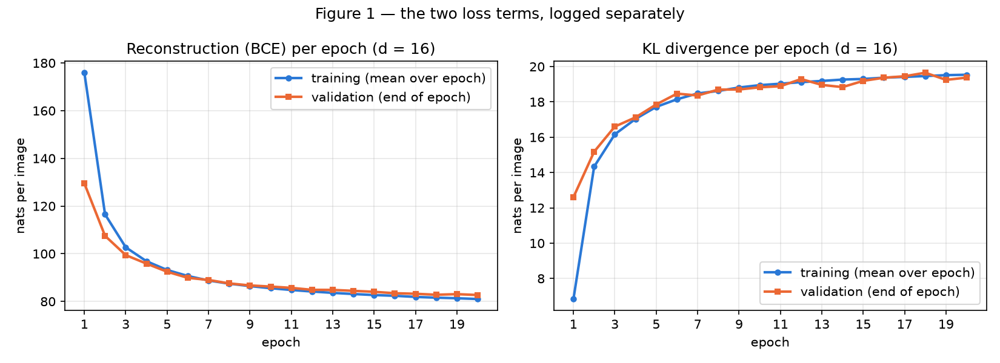
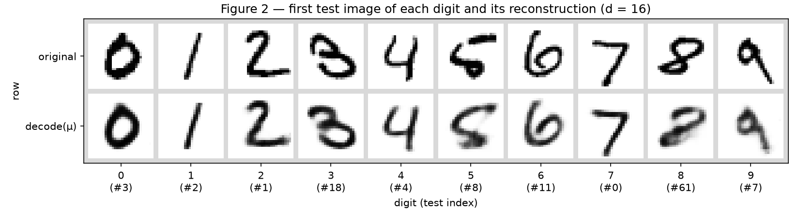
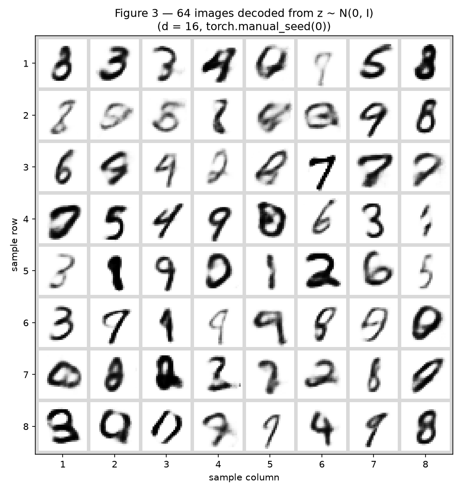
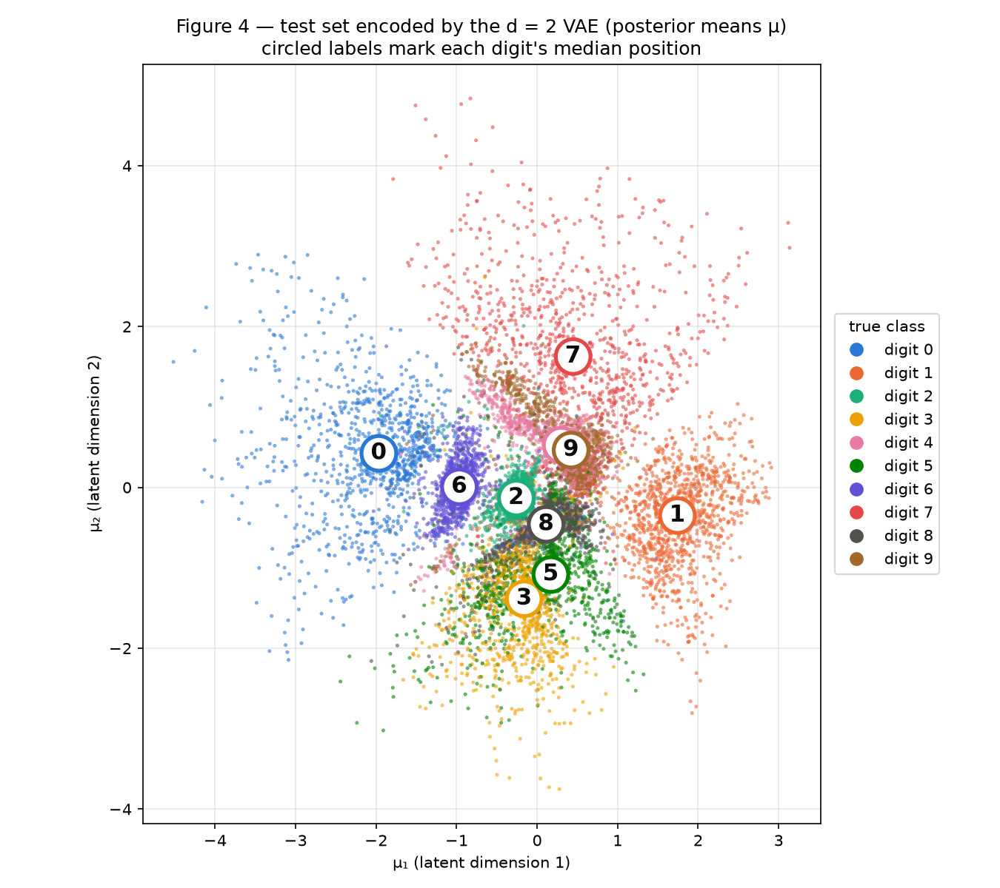
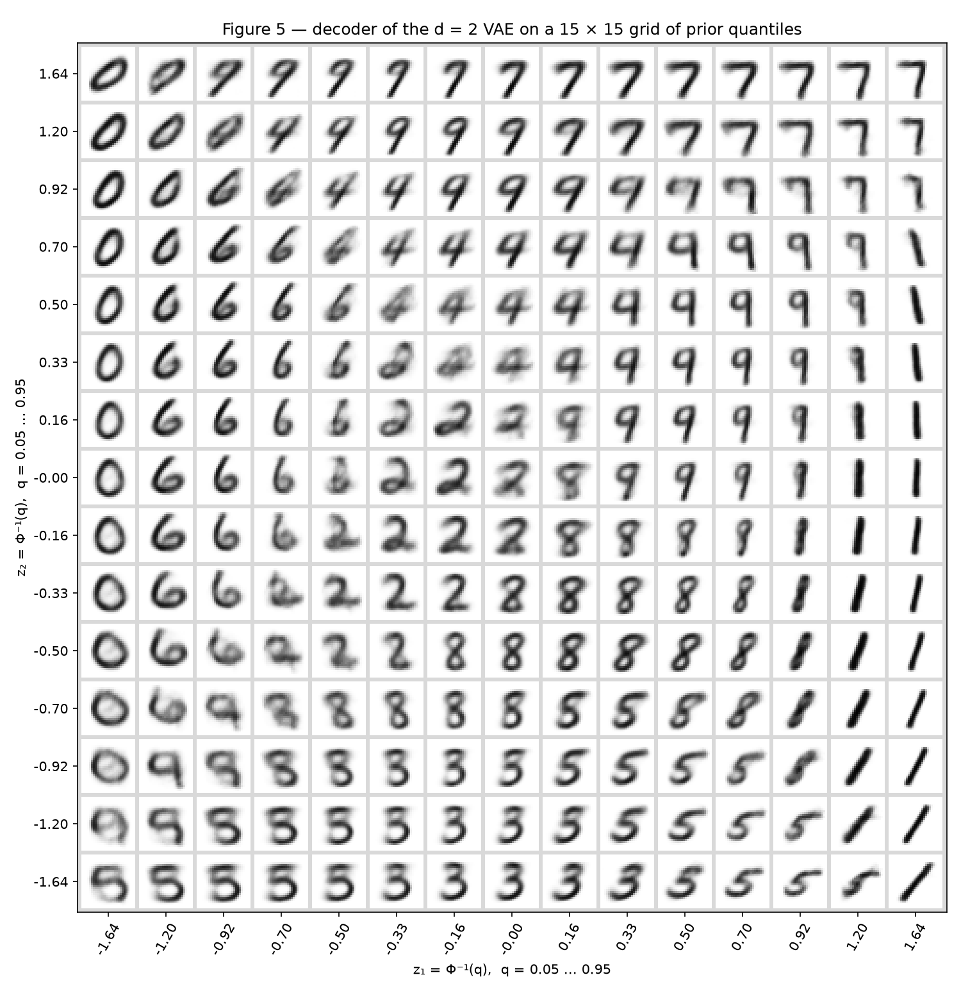
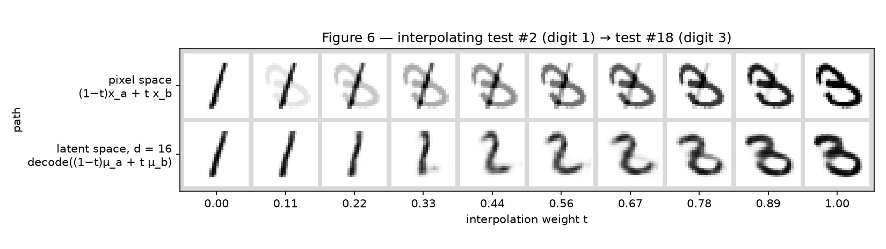

# VAE

!!! abstract "Assignment"

    [Exercises → VAE](https://insper.github.io/ann-dl/2026.2/exercises/vae/){:target='_blank'}

**Implementation approach.** All the VAE code lives in one module,
[`code/vae.py`](https://github.com/Thaisrs165/ann-dl-2026-2/blob/main/docs/exercises/vae/code/vae.py):
the data loading and split, the `VAE` class, the reparameterization, the loss, and the training
loop. Both exercise scripts import it unchanged; Exercise 2 only passes `d=2` instead of `d=16`.
`torch.nn` is used for the linear layers, ReLU and sigmoid, and autograd computes the gradients,
which this activity allows. The VAE-specific parts are written by hand: the reparameterization
\(\mathbf z=\boldsymbol\mu+\boldsymbol\sigma\odot\boldsymbol\varepsilon\), the summed BCE, the
closed-form KL, and the sampling from the prior. No VAE class and no `torch.distributions` are used.

**Randomness.** The split uses `torch.Generator().manual_seed(42)`, as given. `train_vae` calls
`torch.manual_seed(42)` immediately before building each model. That one call fixes the initial
weights, the shuffle of every epoch and every \(\boldsymbol\varepsilon\) drawn during training.
Figure 3 draws its prior samples after `torch.manual_seed(0)`. Exercise 2 needs Exercise 1's
\(d=16\) model for Figure 6, so it rebuilds it with the same seed and the same sequence of calls.
That run reproduces Exercise 1's test numbers exactly (82.07 / 19.41 nats), which confirms it is
the same model. Everything runs on CPU, about 25 s per model (torch 2.15). To reproduce, run from
the repository root (MNIST is downloaded to `./data` on the first run):

```shell
python docs/exercises/vae/code/exercise1_vae.py
python docs/exercises/vae/code/exercise2_latent2d.py
```

**Units.** Every loss number on this page is in **nats per image**: summed over the 784 pixels
(reconstruction) or over the \(d\) latent dimensions (KL), then averaged over the images.

## Exercise 1

### A — Load and split the data

``` { .python .copy .select linenums='1' title="vae.py — data" }
--8<-- "docs/exercises/vae/code/vae.py:data"
```

The split is the one in the statement: 50 000 training and 10 000 validation images drawn from the
60 000 MNIST training images, plus the 10 000 official test images. To avoid 70 000 PIL
conversions, the pixels are read straight from the dataset's `uint8` array and divided by 255. That
is exactly what `ToTensor()` computes, and the rows are selected with the `indices` that
`random_split` returned. Images are flattened to 784-vectors with values in \([0,1]\).

**Use of the test set.** `train_vae` only receives `x_train` and `x_val`, so every quantity logged
during training (Figure 1) comes from those two sets. The test set is touched only after training
has finished: for the final numbers of each model, and for the figures drawn from the trained
model (2, 4, 5 and 6).

### B — Build the model

``` { .python .copy .select linenums='1' title="vae.py — model, reparameterization and loss" }
--8<-- "docs/exercises/vae/code/vae.py:model"
```

| Part | Layers |
|---|---|
| Encoder | \(784 \to 512 \to 256\), ReLU after each |
| Heads | `fc_mu`: \(256 \to d\) for \(\boldsymbol\mu\); `fc_logvar`: \(256 \to d\) for \(\log\boldsymbol\sigma^2\) |
| Decoder | \(d \to 256 \to 512 \to 784\), ReLU after the hidden layers, sigmoid at the output |
| Latent size | \(d=16\) (Exercise 1), \(d=2\) (Exercise 2) |

The loss for one image, implemented in `vae_loss` and averaged over the batch:

\[
L=\underbrace{-\sum_{j=1}^{784}\Big[x_j\log\hat x_j+(1-x_j)\log(1-\hat x_j)\Big]}_{\text{reconstruction}}
\;+\;\beta\cdot\underbrace{\tfrac12\sum_{i=1}^{d}\left(\mu_i^2+\sigma_i^2-1-\log\sigma_i^2\right)}_{\mathrm{KL}\left(q(\mathbf z\mid\mathbf x)\,\|\,\mathcal N(\mathbf 0,\mathbf I)\right)},
\qquad \beta=1 .
\]

- **Reconstruction:** `F.binary_cross_entropy(x_hat, x, reduction="sum") / n` sums over all
  pixels of the batch and divides by the number of images. That gives the per-image sum over the
  784 pixels, the Bernoulli negative log-likelihood \(-\log p(\mathbf x\mid\mathbf z)\).
- **KL:** the closed form above, written out as
  `0.5 * sum(mu² + exp(logvar) − 1 − logvar) / n`. The encoder outputs \(\log\sigma^2\) rather
  than \(\sigma\), so \(\sigma^2=e^{\log\sigma^2}\) is always positive without any constraint.
- **Reparameterization:** `reparameterize` draws \(\boldsymbol\varepsilon\sim\mathcal N(\mathbf
  0,\mathbf I)\) with `randn_like` and returns \(\boldsymbol\mu+e^{\frac12\log\boldsymbol\sigma^2}
  \odot\boldsymbol\varepsilon\). The noise does not depend on the parameters, so the gradient of
  the reconstruction term reaches the encoder through \(\boldsymbol\mu\) and \(\boldsymbol\sigma\).
- `evaluate` uses the same forward pass, with a sampled \(\mathbf z\), so the validation and test
  numbers are the same single-sample estimate of the negative ELBO that training minimises.

### C — Train

``` { .python .copy .select linenums='1' title="vae.py — training loop and evaluation" }
--8<-- "docs/exercises/vae/code/vae.py:train"
```

``` { .python .copy .select linenums='1' title="exercise1_vae.py — training and test numbers" }
--8<-- "docs/exercises/vae/code/exercise1_vae.py:ex1-train"
```

Adam with learning rate \(10^{-3}\), batch size 128, 20 epochs, 391 updates per epoch. The
training terms are averaged over all the mini-batches of an epoch. The validation terms are
computed on the 10 000 validation images at the end of each epoch.

| Epoch | Train recon | Train KL | Val recon | Val KL |
|---:|---:|---:|---:|---:|
| 1 | 175.92 | 6.84 | 129.50 | 12.60 |
| 2 | 116.50 | 14.33 | 107.50 | 15.18 |
| 5 | 93.18 | 17.72 | 92.44 | 17.85 |
| 10 | 85.54 | 18.95 | 86.23 | 18.83 |
| 20 | 81.02 | 19.54 | 82.69 | 19.38 |

**Test result (\(d=16\)): reconstruction 82.07, KL 19.41, negative ELBO 101.48 nats per image.**
These are close to the reference values of about 81 and 20.

In epoch 1, the training KL (6.84) is lower than the validation KL (12.60), and the training
reconstruction (175.92) is higher than the validation one (129.50). The training numbers are
averages over the epoch, so they include the first batches, when the network was still almost at
its initialisation. The validation numbers are measured after the 391st update. From epoch 3 on,
the two curves overlap. At epoch 20 the validation reconstruction is 1.7 nats above the training
one, a small gap.


/// caption
**Figure 1 —** The two loss terms of the \(d=16\) VAE per epoch, on the training set (blue, mean
over the epoch) and the validation set (orange, end of epoch). Reconstruction falls from 175.9 to
81.0 nats on the training set; KL **rises** from 6.8 to 19.5 and flattens after about 10 epochs.
///

### D — Reconstructions and samples

``` { .python .copy .select linenums='1' title="exercise1_vae.py — Figures 2 and 3" }
--8<-- "docs/exercises/vae/code/exercise1_vae.py:ex1-figures"
```


/// caption
**Figure 2 —** Top: the first test image of each digit 0–9 (test indices 3, 2, 1, 18, 4, 8, 11, 0,
61, 7). Bottom: \(\text{decode}(\boldsymbol\mu)\), with no sampling of \(\mathbf z\). Nine of the
ten keep their digit and slant with slightly softened edges. The unusual 8 (#61), written
almost flat, is the worst: its reconstruction is a smeared shape that leans toward a 2.
///


/// caption
**Figure 3 —** 64 images decoded from \(\mathbf z\sim\mathcal N(\mathbf 0,\mathbf I_{16})\), drawn
after `torch.manual_seed(0)`. Most are recognisable digits but blurrier than Figure 2. Some are
faint (row 2), and some are no digit at all: the scribbles at (2, 5), (2, 6) and (7, 3).
///

### E — Analysis

**Why the KL rises while the total loss falls (Figure 1).** At initialisation the encoder's heads
output \(\boldsymbol\mu\approx\mathbf 0\) and \(\log\boldsymbol\sigma^2\approx\mathbf 0\), so
\(q(\mathbf z\mid\mathbf x)\approx\mathcal N(\mathbf 0,\mathbf I)\) for every image. That makes the
KL almost zero. It also means \(\mathbf z\) carries no information about \(\mathbf x\): the decoder
can only output something like the average digit, and the reconstruction term is very large. The
KL is the price of information. Moving \(\boldsymbol\mu\) away from 0 and shrinking
\(\boldsymbol\sigma\) is what lets \(\mathbf z\) say which image it came from, and the KL charges
for exactly that. The optimizer pays as long as one extra nat of KL buys more than one nat of
reconstruction, and early in training it buys far more. On the validation set, from epoch 1 to
epoch 20 the KL rises by 6.78 nats (12.60 → 19.38) while the reconstruction falls by 46.81 nats
(129.50 → 82.69), so the total drops by 40.0 nats. After about epoch 10 the KL flattens near
19.4. From there, more information in \(\mathbf z\) costs about as much KL as it saves in
reconstruction. The same balance shows up per dimension. On the test set, **5 of the 16 latent
dimensions have KL 0.00** (posterior \(\sigma\approx 1\), \(\mu\approx 0\), i.e. the prior itself).
The optimizer decided that using them would cost more KL than it saves. The 11 active dimensions
each cost between 1.08 and 2.51 nats.

**Why Figure 3 looks worse than Figure 2: two separate reasons.**

1. *Where the prior samples land.* The KL pulls each \(q(\mathbf z\mid\mathbf x)\) toward
   \(\mathcal N(\mathbf 0,\mathbf I)\) but does not make them equal to it. On the active
   dimensions the posteriors are narrow (mean \(\sigma=0.197\), against 1 for the prior), so each
   training image only covers a small ball of latent space. The union of those balls (the
   *aggregate posterior*) has gaps and low-density regions that the prior still assigns mass to.
   During training, the decoder only ever sees codes drawn from these balls. A prior sample often
   lands in a gap. Measured on the test set, the 64 prior samples of Figure 3 are a median
   **2.61** away from the nearest encoded test image (\(\boldsymbol\mu\)). A test code's nearest
   other test code is a median **1.26** away. So the prior samples sit about twice as far from the
   data as the data sits from itself, in places where the decoder was never trained. There it
   produces faint strokes or shapes between classes, like the scribbles in rows 2 and 7.
2. *What the decoder outputs for a given \(\mathbf z\).* The decoder does not output an image. It
   outputs, for each pixel, the probability \(\hat x_j\) that it is on. The value that minimises
   the BCE is the average of \(x_j\) over all the training images that could have produced that
   \(\mathbf z\). Whenever several images (different slants, thicknesses, or even different
   digits) are compatible with the same \(\mathbf z\), the output is their pixel-wise average. A
   stroke that sits in slightly different places in those images becomes a wide grey band, and the
   result is blur. Figure 2 decodes \(\boldsymbol\mu\) of one real image, the most specific point
   of that image's posterior, so the average is over a narrow set of images that all look alike. A
   random prior sample is, more often, a point many different images could have produced, so its
   average is blurrier. (We plot \(\hat x_j\) itself rather than Bernoulli-sampled pixels, so the
   uncertainty shows up as grey.)

**Why decode \(\boldsymbol\mu\), not a sampled \(\mathbf z\), in Figure 2.** Figure 2 is meant to show
what the model *encoded* about each image. \(\boldsymbol\mu\) is the centre (and the mode) of the
posterior \(q(\mathbf z\mid\mathbf x)\). Decoding it gives the model's best single guess, and the
result is deterministic and reproducible. A sampled \(\mathbf z=\boldsymbol\mu+\boldsymbol\sigma
\odot\boldsymbol\varepsilon\) adds random noise of size \(\sigma\approx 0.2\) on each active
dimension. That shows a random neighbour instead (another slant or thickness, sometimes a
different digit), so the figure would mix reconstruction quality with sampling noise. Sampling is
what the ELBO needs during training. For displaying a reconstruction, it only adds noise.

## Exercise 2

### A — Train a 2-D VAE

``` { .python .copy .select linenums='1' title="exercise2_latent2d.py — training both models" }
--8<-- "docs/exercises/vae/code/exercise2_latent2d.py:ex2-train"
```

Same data, architecture, seed (42), \(\beta=1\), optimizer and budget (Adam \(10^{-3}\), batch 128,
20 epochs). The only change is `d=2`.

| Test set, nats per image | \(d=16\) (Ex. 1) | \(d=2\) | Difference |
|---|---:|---:|---:|
| Reconstruction | 82.07 | **135.22** | +53.15 |
| KL | 19.41 | **6.70** | −12.71 |
| Negative ELBO | 101.48 | 141.92 | +40.44 |

These match the expected values of about 135 and 7. The validation KL of the \(d=2\) model went
from 5.10 (epoch 1) to 6.69 (epoch 20). The two dimensions cost 3.4 and 3.3 nats each, about twice
what one active dimension of the \(d=16\) model costs (1.1–2.5). With only two coordinates, each
must carry more information. The posteriors are correspondingly narrow: mean \(\sigma = 0.043\) and
0.045 per dimension.

### B — The encoded test set


/// caption
**Figure 4 —** \(\boldsymbol\mu\) of all 10 000 test images under the \(d=2\) model, coloured by true
digit, with a legend. Each circled number marks that digit's median position, so the classes can
be told apart without relying on colour. 0, 1, 6, 2 and 7 form their own regions. 4/9 and
3/5/8 pile up in the centre.
///

### C — The decoded plane

``` { .python .copy .select linenums='1' title="exercise2_latent2d.py — Figures 4–6" }
--8<-- "docs/exercises/vae/code/exercise2_latent2d.py:ex2-figures"
```

The grid points are \(z=\Phi^{-1}(q)\) for 15 evenly spaced \(q\in[0.05,0.95]\), giving
\(z\in\{-1.645,-1.204,\ldots,0,\ldots,1.204,1.645\}\) on each axis. The rows run from \(z_2=1.645\)
at the top to \(-1.645\) at the bottom, so Figure 5 has the same orientation as Figure 4.

**Why this spacing.** Neighbouring grid values are always \(\Delta q = 0.9/14 \approx 0.064\) apart
in cumulative probability, and the prior factorises as \(\mathcal N(0,1)\times\mathcal N(0,1)\).
So every cell between neighbouring grid points holds the same prior mass, \((0.064)^2\approx
0.0041\). The grid is dense near the origin, where the prior (and the data) are concentrated, and
sparse in the tails. A linear grid would spend most of its cells on regions the prior almost never
samples.


/// caption
**Figure 5 —** The \(d=2\) decoder evaluated on the \(15\times15\) quantile grid, tiled in the same
layout (\(z_1\) left→right, \(z_2\) bottom→top). Digits occupy regions in the same places as in
Figure 4: 0 on the left, 1 on the right, 7 at the top right, 6 left of centre, 2 in the centre,
4/9 above it, and 3/5/8 below. The square covers 75.2% of the test codes.
///

### D — Interpolation

The two test images are **test #2 (a 1) and test #18 (a 3)**: the first 1 and the first 3 of the
test set, both shown in Figure 2. The top row is the straight line in pixel space; the bottom row
decodes the straight line between the two encodings \(\boldsymbol\mu_a,\boldsymbol\mu_b\) of the
**\(d=16\) model of Exercise 1**. In both rows \(t=0,\tfrac19,\ldots,1\).


/// caption
**Figure 6 —** Top: \((1-t)\,\mathbf x_a+t\,\mathbf x_b\). Bottom:
\(\text{decode}\big((1-t)\boldsymbol\mu_a+t\boldsymbol\mu_b\big)\) with the \(d=16\) model. Test
#2 (digit 1) → test #18 (digit 3).
///

**How the pair was chosen.** I looked at a few candidate pairs before picking this one. The first
one I tried, test #3 (a 0) → test #2 (a 1), has a latent path that crosses an unreadable smudge
around \(t\approx0.5\). So a straight latent line does not *always* stay on digits; see 2E.

### E — Analysis

**Which digits overlap (Figure 4), and the same transition in Figure 5.** The largest overlap is
**4 and 9**. Their clusters sit on top of each other just above the centre: the medians are about
0.15 apart, and the pink and brown points are interleaved. Next comes the **3/5/8** group below
the centre, with a weaker 7–9 contact. To put numbers on it, each test \(\boldsymbol\mu\) was
classified by majority vote of its 10 nearest other test \(\boldsymbol\mu\)s. The pairs most
often mixed up, counting both directions, are 4–9 (621 images), 3–5 (360), 3–8 (162), 5–8 (160)
and 7–9 (158). Overall 10-NN accuracy is 0.789. Per digit it is lowest for 9 (0.56), 5 (0.57) and
4 (0.66), and highest for 1 (0.98) and 0 (0.97). In Figure 5 the 4→9 transition runs along the
rows \(z_2\approx0.50\)–\(0.92\), moving right from \(z_1\approx-0.5\) to \(0.5\). On the row
\(z_2=0.70\) the cells read 6, 6, 6, a blurry 6/4, then a sequence of 4s whose top gradually
closes, then 9s from \(z_1\approx0.50\). The in-between images are **plausible hybrids rather than
blends**: a 4 with its two upper strokes pulled together until they form the 9's closed loop. Some
cells look like either digit. Where three classes meet (\(z_2\approx0.16\)–\(0.33\),
\(z_1\approx-0.33\)–\(0\), between 2, 4 and 6) the cells do become grey overlapping strokes that
are no digit. The 3/5/8 region below the centre does the same: 8 → 3 down the column
\(z_1\approx-0.16\), and along the bottom rows 5s on the left, 3s in the middle and 5s again on the
right, with in-between 3s whose upper-left stroke opens into the 5's flag.

**What two numbers per image force the model to throw away.** Reconstruction goes from 82.07 to
135.22 nats (+53.15 per image). Two coordinates are mostly spent on *which digit* it is. The
plane is carved into ten class regions, so within each class only about one continuous degree of
freedom is left, and every individual detail must be discarded. Figure 5 shows this. Each
digit appears as one smooth, averaged prototype that varies along a single direction. The 1s in
the right-hand columns only change slant, from vertical at the top to leaning right at the bottom.
The 0s on the left only change width and tilt. The 7s at the top right only change the angle of
their stem. Nothing in the plane encodes stroke thickness independently of identity, or the small
hooks, serifs, gaps and loops that make one person's 7 different from another's. Every
reconstruction is pulled to the nearest prototype, and the BCE charges for every pixel where the
real stroke differs. The per-digit test reconstruction (from \(\boldsymbol\mu\)) supports this.
The loss is smallest for the simplest shape, 1 (50.8 nats for \(d=2\) vs 35.5 for \(d=16\)), and
largest for the shapes with the most variation, 2 (169.1 vs 92.4) and 8 (161.9 vs 97.2). The KL
is lower too (6.70 vs 19.41), and that is no saving: it simply means \(\mathbf z\) carries less
information about each image.

**The two rows of Figure 6.** The **latent row** passes through images that look like digits. The
1 grows a foot at \(t=0.33\), becomes a clear 2 at \(t=0.44\)–\(0.67\), and the 2's lower stroke
then curls into the 3, so every frame is one coherent stroke. The **pixel row** does not. Every
in-between frame is the 1 and the 3 superimposed at partial intensity, for example the 3 with a
grey slash through it at \(t=0.44\)–\(0.56\). That is not a digit. Images of digits do not form a
convex set in pixel space. The strokes of the 1 and the 3 occupy *different* pixels, so averaging
pixels cannot move a stroke from one place to the other. It only dims one image while brightening
the other. In latent space, the KL term packs the codes of all training images into one
continuous region around the origin. The straight line from \(\boldsymbol\mu_a\) to
\(\boldsymbol\mu_b\) therefore runs through codes that real images (here, 2s) also occupy. The
nonlinear decoder maps each of those points to a single coherent image, so moving \(\mathbf z\)
moves the strokes instead of cross-fading them. This holds only where the line stays inside the
region covered by data. The 0 → 1 pair mentioned in 2D shows that a line can cross a gap between
clusters, and the frames in that gap smear.

## Results summary

|  # | Quantity | Value |
| -: | -------- | ----- |
|  1 | Ex. 1 — test reconstruction, KL and negative ELBO (\(d=16\)) | 82.07 / 19.41 / **101.48** nats per image |
|  2 | Ex. 1 — validation KL at the first and at the last epoch | 12.60 (epoch 1) → 19.38 (epoch 20) nats per image |
|  3 | Ex. 2 — test reconstruction and KL (\(d=2\)) | 135.22 / 6.70 nats per image (negative ELBO 141.92) |
|  4 | Ex. 2 — the two test indices interpolated | test #2 (digit 1) and test #18 (digit 3) |

!!! info "AI-Use"

    Claude (Claude Code) was used to help interpret the assignment, write and debug the PyTorch
    code (the VAE model, the loss, the training loop and the figures), compute the supporting
    statistics (per-dimension KL, nearest-neighbour distances, the 10-NN overlap count), and draft
    and organize the report. I reviewed every line of code and every explanation, ran all the
    scripts myself, and every number in this report comes from those runs.
